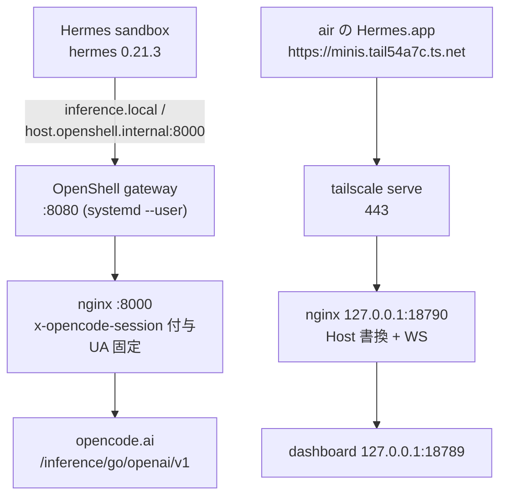

# NemoHermes (NVIDIA NemoClaw)

minis 上で NVIDIA NemoClaw の Hermes エージェントを常駐させ、推論に **OpenCode Go** を使う構成。
2026-11-01 にインストールし、サンドボックス `hermes` が稼働している。

| 項目 | 値 |
| --- | --- |
| NemoHermes CLI | v0.0.140 (`~/.local/bin/nemohermes`) |
| OpenShell | 0.0.116（gateway は systemd --user で常駐） |
| サンドボックス | `hermes`（rootless Podman, CPU only） |
| Hermes Agent | v0.21.3（NemoClaw のイメージ固定値） |
| 推論 | `compatible-endpoint` / `deepseek-v4.1-flash`（OpenCode Go） |
| dashboard / API | `127.0.0.1:18789` / `127.0.0.1:8642`（loopback）+ `https://minis.tail54a7c.ts.net/`（tailnet, air のみ） |

## 構成



OpenCode Go は `x-opencode-session` ヘッダが無いリクエストを 400 で拒否し、
汎用 UA（`python-urllib` など）を Cloudflare 1010 で弾く。NemoClaw の検証プローブにも
サンドボックスの Hermes 0.21.3 にもその対応が無いため、**nginx で補う**。
nginx は認証ヘッダを素通しするだけで、API キーは保持しない。

dashboard 側は Host ヘッダを検証しており、`Host: 127.0.0.1:18789` 以外は 400 になる。
`tailscale serve` は Host をそのまま流すので、間に Host を書き換える nginx を挟んでいる。

## NixOS 側 (`modules/nemohermes.nix`)

| 設定 | 理由 |
| --- | --- |
| `nodejs_22` / `binutils` / `lsof` | installer の preflight（Node >= 22.19, npm >= 10, `strings`, `lsof`） |
| `users.users.halby.linger = true` | `nemoclaw-openshell-gateway.service` をログアウト後も動かす |
| `/bin/bash` symlink | `bin/nemoclaw.js` が gateway port 解決に `spawnSync("/bin/bash")` |
| `/bin/ps` symlink | OpenShell の forward 所有権確認が `/bin/ps` 固定 |
| `/bin/sleep` symlink | 同様にハードコードされている |
| `/usr/bin/lsof` symlink | forward 監視が `/usr/bin/lsof -ti4TCP:<port>` 固定。無いと forward が必ず失敗する |
| `NEMOCLAW_GATEWAY_PORT=8080` | 未設定だと `PATH=/usr/bin:/bin` で resolver を呼び、NixOS では `dirname` が無く失敗 |
| `programs.nix-ld` | npm 製の汎用 ELF（prek 等）を動かす |
| `~/.local/bin/podman` shim | Podman アダプタが `podman` の realpath の親を検査し、`/nix/store` (1775) を拒否するため |
| `services.nginx` :8000 | OpenCode Go 用のヘッダ注入（上記） |
| `services.nginx` :18790 | tailnet 用 dashboard プロキシ（Host を `127.0.0.1:18789` に書換 + WS） |
| `nemohermes-tailscale-serve.service` | 起動時に `tailscale serve --bg 18790`（443 → 18790）を適用 |
| `networking.firewall.allowedTCPPorts = [ 8000 ]` | nginx 側で 127.0.0.1 / 10/8 / 172.16/12 / 169.254/16 のみ許可、LAN・tailnet は拒否 |

## インストール（実行済み）

```sh
# 1. CLI と OpenShell（onboarding は後回し）
export NEMOCLAW_AGENT=hermes NEMOCLAW_GATEWAY_RUNTIME=podman \
       NEMOCLAW_DEFER_ONBOARDING=1 NEMOCLAW_PROVIDER=build \
       NEMOCLAW_DISABLE_TELEMETRY=1 NEMOCLAW_ACCEPT_THIRD_PARTY_SOFTWARE=1
curl -fsSL https://www.nvidia.com/nemoclaw.sh | bash

# 2. サンドボックス作成（キーは 1Password から stdin で渡す）
op read "op://Personal/<item-id>/credential" | ssh minis 'read -r COMPATIBLE_API_KEY
  export COMPATIBLE_API_KEY PATH="$HOME/.local/bin:$PATH"
  export NEMOCLAW_GATEWAY_RUNTIME=podman NEMOCLAW_PROVIDER=custom \
         NEMOCLAW_ENDPOINT_URL=http://127.0.0.1:8000/v1 \
         NEMOCLAW_MODEL=deepseek-v4.1-flash NEMOCLAW_SANDBOX_NAME=hermes \
         NEMOCLAW_WEB_SEARCH_PROVIDER=none NEMOCLAW_DISABLE_TELEMETRY=1 \
         NEMOCLAW_ACCEPT_THIRD_PARTY_SOFTWARE=1
  nemohermes onboard --non-interactive </dev/null'
```

`--defer-onboarding` は「プロバイダ未決定のまま CLI だけ入れる」指定で、
NVIDIA ホスト推論しか許さないため `NEMOCLAW_PROVIDER=build` を添える（値は記録されない）。
onboarding のログは `~/nemoclaw-onboard-*.log`。

## キー管理

- **正本は 1Password**（項目: `OpenCode Go (NemoHermes)` / API Credential）。
  minis には置かない。実体は OpenShell gateway の provider store にだけ入る。
- 受け渡しは `op read ... | ssh minis 'read -r COMPATIBLE_API_KEY'` のように **stdin**。
  コマンドライン引数・シェル履歴・ファイルに残さない。
- ローテーション: Console で新キー発行 → 1Password 更新 →
  `nemohermes credentials reset <provider> --yes` → 再 onboarding（または `credentials add`）→ 旧キー失効。
- OpenCode Go の利用上限は **workspace 単位**。NemoClaw が消費する分も同じ枠に入る。

## 運用

```sh
export PATH="$HOME/.local/bin:$PATH"

nemohermes list                  # サンドボックス一覧
nemohermes hermes status
nemohermes hermes doctor         # 総合ヘルスチェック
nemohermes hermes logs --follow
nemohermes hermes recover        # 再起動後に forward を復旧
nemohermes inference set --model <model> --provider custom --sandbox hermes
```

### tailnet から見る（Hermes.app / ブラウザ）

air からは `https://minis.tail54a7c.ts.net/` で dashboard に入れる（SSH トンネル不要）。

- 経路: `tailscale serve`(443) → nginx `127.0.0.1:18790`（Host 書換 + WS）→ dashboard
- tailnet ACL: `air → minis tcp:443` を許可（`tailscale/acl.hujson`）
- Hermes.app: **Add connection → Remote**
  - URL `https://minis.tail54a7c.ts.net`
  - Auth `Token` = dashboard HTML の `__HERMES_SESSION_TOKEN__`
  - 取得: `ssh minis "curl -s http://127.0.0.1:18789/ | sed -n 's/.*__HERMES_SESSION_TOKEN__=\"\([^\"]*\)\".*/\1/p' | head -1"`
- **dashboard のセッショントークンは sandbox を再起動すると変わる**（`stop`/`start`・
  ホスト再起動）。**`gateway restart` では変わらない**（2026-11-02 実測: PID は変わるが
  トークンは同一）。
  - air 側は `nh-sandbox-restart` で「stop → start → forward 復旧 → Hermes.app の設定
    （`connection.json` / `connections.json`）へ新トークン書き込み → アプリ再起動」まで自動。
  - 手動同期は `nh-sync-token --restart`（`--restart` 無しは書き込みのみ）。
  - アプリ UI で貼り替える場合、**空欄保存は古いトークンを維持する**ので、変わったら
    必ず新しい値を入れる。
  - `.env` に固定すると NemoClaw の secret boundary が `SECRET_BOUNDARY_REFUSED` で拒否する。
- 443 が届かないときのフォールバック: `ssh -N -L 18789:127.0.0.1:18789 minis`
  → `http://127.0.0.1:18789/`
- API は 8642 のままで tailnet 非公開。使うときは `ssh -L 8642:127.0.0.1:8642 minis`
  → `http://127.0.0.1:8642/v1`（トークンは `nemohermes hermes gateway-token --quiet`）
- **再起動後**: gateway とサンドボックスは自動で戻るが、host forward（18789/8642）は
  detached プロセスなので `nemohermes hermes recover` で張り直す。
- アンインストール: `nemohermes uninstall`。`~/.nemoclaw` と `~/.local/bin` の shim は手で消す。

## つまずいた点（再発防止）

1. **rsync で `.git` ファイルを運ばない。** submodule の `.git`（`gitdir: ../../.git/modules/...`）を
   コピーすると `nixos-rebuild --flake ~/minis#minis` が
   `failed to resolve path .../.git/modules/vps/minis` で落ちる。`--exclude='.git'`（ディレクトリだけでなくファイルも）。
2. **NixOS に無いハードコードパス**: `/bin/bash`, `/bin/ps`, `/bin/sleep`, `/usr/bin/lsof`。
   症状は「gateway port が解決できない」「forward が必ず cleanup_uncertain で失敗」。
3. **Podman executable authority**: `/nix/store` が group writable なため、システムの podman を
   そのまま使えない。`~/.local/bin/podman` の shim で realpath をストア外へ。
4. **OpenCode Go の 400 `MissingSessionID`**: 全リクエストに `x-opencode-session` が必要。
   NemoClaw の検証プローブにはヘッダ追加手段が無い（`getProbeExtraHeaders` は OpenRouter 専用）。
5. **Cloudflare 1010**: `python-urllib` などの汎用 UA は 403。nginx で UA を固定する。
6. **forward は ssh の known_hosts を使う** ことがある。初回だけ手動で
   `openshell forward start <port> hermes` を流すと host key が入る（今回の環境では
   最終的に `/usr/bin/lsof` が原因だった）。
7. 起動時の `ExperimentalWarning: SQLite is an experimental feature` は Node 22 の警告で無害。

## 既知の制約

- サンドボックスの Hermes は **0.21.3** 固定。OpenCode Go が validated としているのは
  **0.21.6+**（`x-opencode-session` を自分で送る版）。現在は nginx が補っているため動作するが、
  NemoClaw が Hermes を更新したら proxy の必要性を再確認する。
- OpenCode Go のセッション ID は proxy で固定値（`ses_nemohermes_minis`）。
  会話ごとの routing/caching 最適化は効かない。Hermes 側がヘッダを送る版になれば
  その値が優先される（nginx の `map` でパススルー）。
- サンドボックスは CPU のみ。ローカル推論はしない前提。
